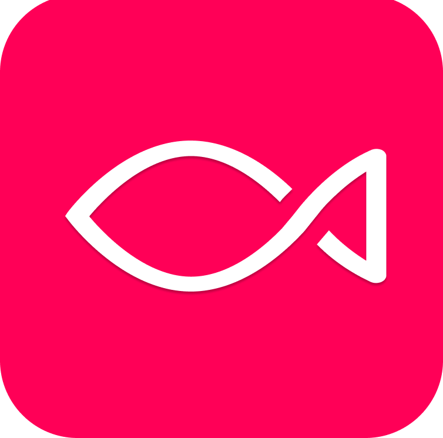
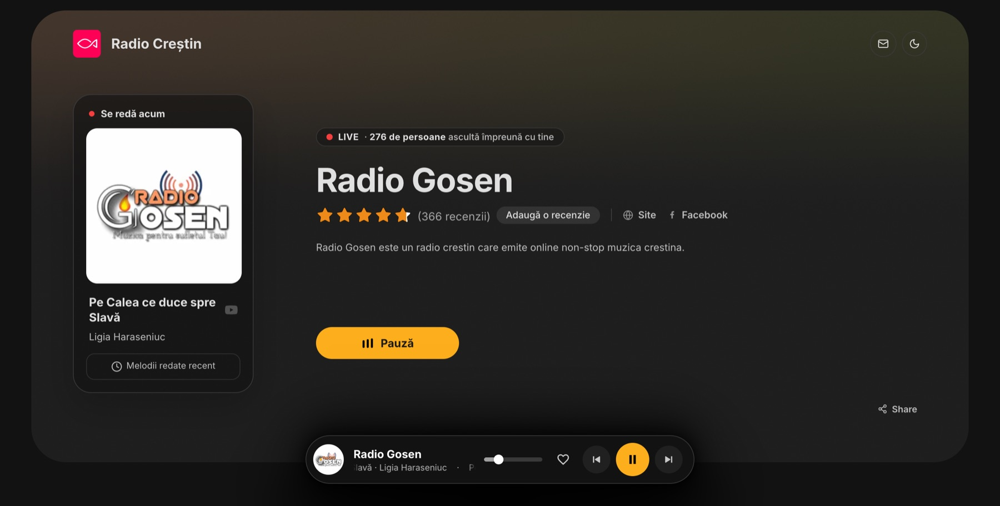
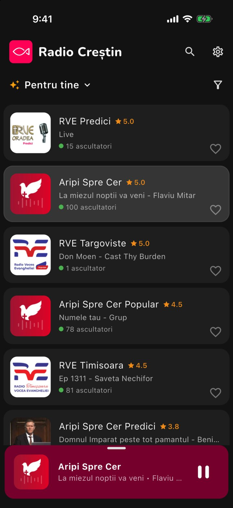
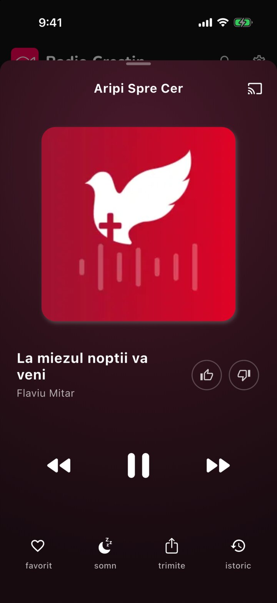
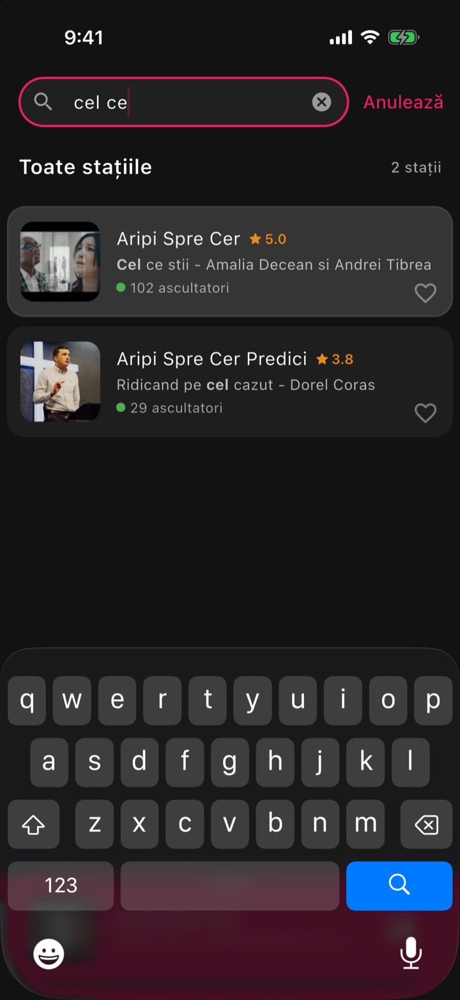
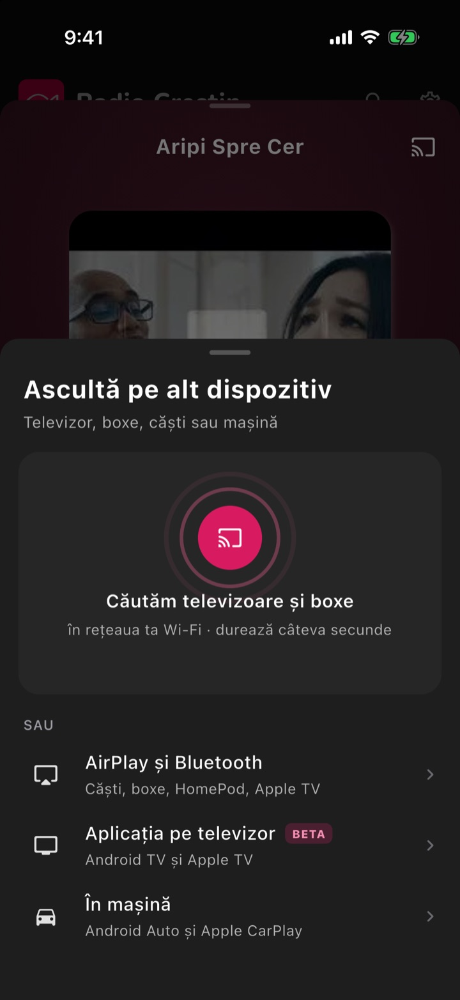
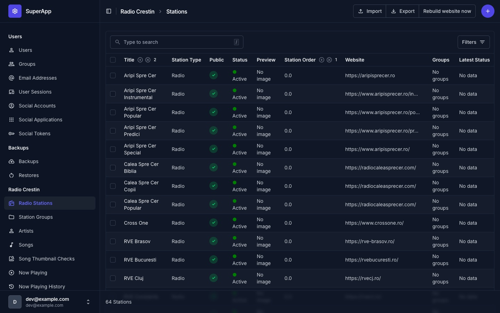
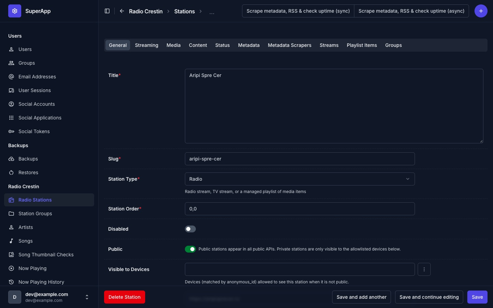
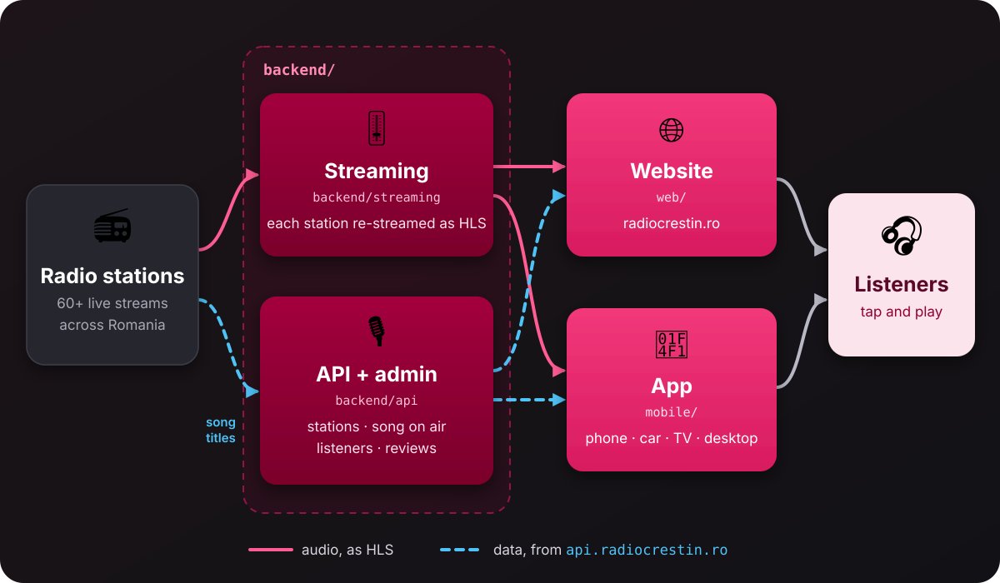

<p align="center">
  
</p>

<h1 align="center">Radio Crestin</h1>

<p align="center">
  Romanian Christian radio in one place: 60+ stations, the song playing now and how many people listen,
  on the web, on your phone, in the car and on the TV.
</p>

<p align="center">
  <a href="https://github.com/radio-crestin/radiocrestin.ro/actions/workflows/ci.yml"></a>
  <a href="https://www.radiocrestin.ro"></a>
  <a href="https://github.com/radio-crestin/radiocrestin.ro/releases/latest"></a>
</p>

<p align="center">
  <a href="https://www.radiocrestin.ro"><b>🌐 radiocrestin.ro</b></a>
  &nbsp;·&nbsp;
  <a href="https://apps.apple.com/app/6451270471"><b>📱 App Store</b></a>
  &nbsp;·&nbsp;
  <a href="https://play.google.com/store/apps/details?id=com.radiocrestin.radio_crestin"><b>🤖 Google Play</b></a>
</p>

### 🌐 Website

<p align="center">
  
</p>

### 📱 App

<p align="center">
  
  &nbsp;
  
  &nbsp;
  
  &nbsp;
  
</p>

### 🎙️ Backend admin

<p align="center">
  
  &nbsp;
  
</p>

## 📦 What's in this repository

One repository, three apps. Each folder has its own README with setup steps, screenshots and conventions.

| Folder | What it is | Built with | Ships to |
|---|---|---|---|
| [`web/`](web/) | The **radiocrestin.ro** website: every station, live song, reviews, listening stats | Astro + React, TypeScript | Cloudflare Workers (static assets), on every push to `main` |
| [`mobile/`](mobile/) | The **Radio Crestin app** for iPhone, Android, CarPlay, Android Auto, Apple TV, Android TV, Mac and Windows | Flutter (+ SwiftUI on Apple TV) | App Store, Google Play, [GitHub releases](https://github.com/radio-crestin/radiocrestin.ro/releases/latest) |
| [`backend/`](backend/) | The **API and admin**: station list, song on air, listeners, reviews, announcements, and every station re-streamed as HLS | Django, GraphQL + REST, Celery, FFmpeg | Kubernetes, via [`backend/deploy`](backend/README.md#-deploying) |

## How it fits together

<p align="center">
  
</p>

- **Streaming** (`backend/streaming`) pulls each station's stream once and re-serves it as HLS, so a
  slow station server never stalls thousands of listeners.
- **The API** (`backend/api`) keeps the station list, reads the song each station plays, counts
  listeners and serves it all at [`api.radiocrestin.ro`](#-public-api). Station owners and admins manage everything in its
  admin portal.
- **The website** and **the app** read that API and play the streams, HLS first, then the station's
  own stream if HLS fails.

## 📡 Public API

The station data behind the website and the app is public, as JSON, no key needed:

| URL | What you get |
|---|---|
| [api.radiocrestin.ro/api/v1/stations](https://api.radiocrestin.ro/api/v1/stations) | Every station: the song on air, listeners, logo, stream URLs (HLS and the station's own) |
| [api.radiocrestin.ro/api/v1/docs/](https://api.radiocrestin.ro/api/v1/docs/) | Interactive docs for every endpoint |

```bash
curl -sL https://api.radiocrestin.ro/api/v1/stations | jq '.data.stations[0].title'
```

## 🛠️ Quick start for developers

```bash
git clone https://github.com/radio-crestin/radiocrestin.ro.git
cd radiocrestin.ro
```

Then pick the app you want to work on. None of them needs the others running: the website and the app
use the production API by default.

| | Needs | Run it |
|---|---|---|
| 🌐 **Website** | Node 24 | `cd web && npm ci && npm run dev` → http://localhost:3005 |
| 📱 **App** | [FVM](https://fvm.app), Xcode / Android Studio | `cd mobile && fvm install && fvm flutter run` |
| 🎙️ **Backend** | Docker | `cd backend && cp .env.example .env && make start-docker` → http://localhost:8080 |

Full setup, tests and conventions: [`web/README.md`](web/README.md) ·
[`mobile/README.md`](mobile/README.md) · [`backend/README.md`](backend/README.md).

## 🚀 Releases

Each app is versioned and released on its own, with tags named after its folder:

| App | Tag | How |
|---|---|---|
| 🌐 Website | `web/v1.2.3` | Deploys continuously from `main`. Push a tag to mark a milestone: [CI](.github/workflows/release.yml) writes the release notes from `web/` commits. |
| 🎙️ Backend | `backend/v1.1.187` | `make create-new-release` in `backend/` builds the images and tags them; pushing the tag publishes the [release](.github/workflows/release.yml). |
| 📱 App | `mobile/v1.6.3` | `make release` in `mobile/` builds, signs and publishes with the downloads attached ([guide](mobile/docs/releasing.md)). |

The repository's **latest** release is always the app's, so
`https://github.com/radio-crestin/radiocrestin.ro/releases/latest/download/radio-crestin-android.apk`
(and the `.dmg`, `.ipa`, Windows `.zip`) always points at the newest app build.

## 🤝 Contributing

1. Branch from `main` and open a pull request. `main` is protected: a PR merges once **CI** passes, and CI
   checks only the apps your change touches.
2. Keep commits small, each with a message that says what changed and why.
3. Each app's `CLAUDE.md` holds its conventions (for people and for AI assistants alike).

Questions, ideas or a station to add: **contact@radio-crestin.com**, or
[open an issue](https://github.com/radio-crestin/radiocrestin.ro/issues).

## 📜 License

This project may be used only by Christian organizations, for non-commercial purposes, in projects the
owner has approved. See [LICENSE](LICENSE).
