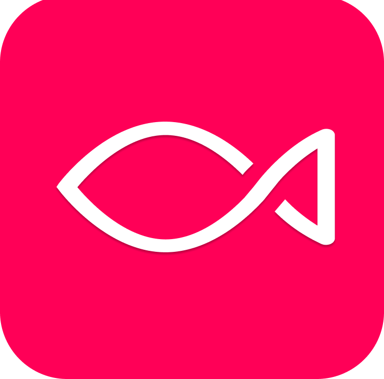
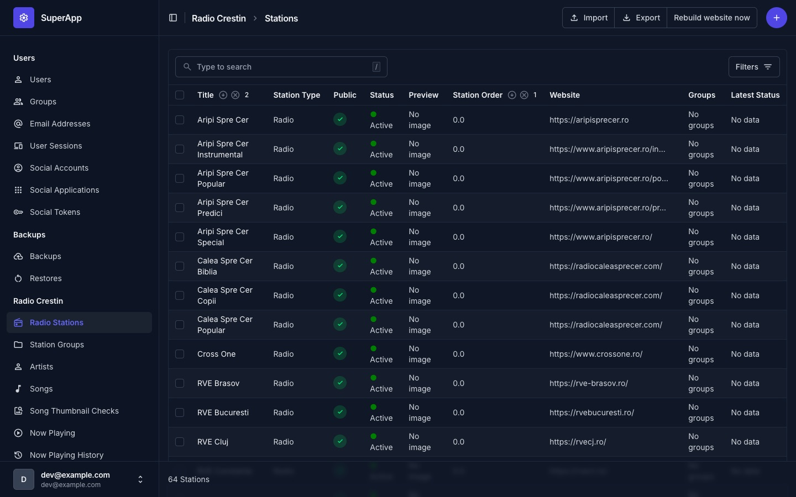
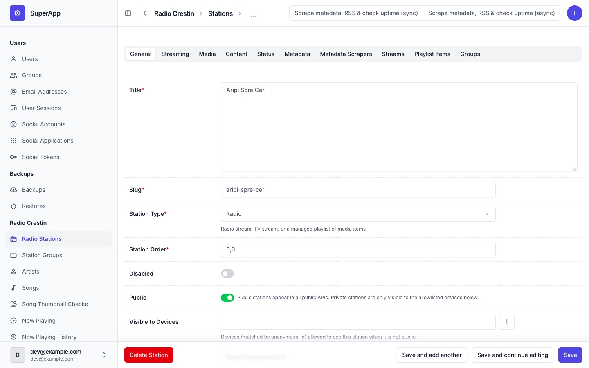
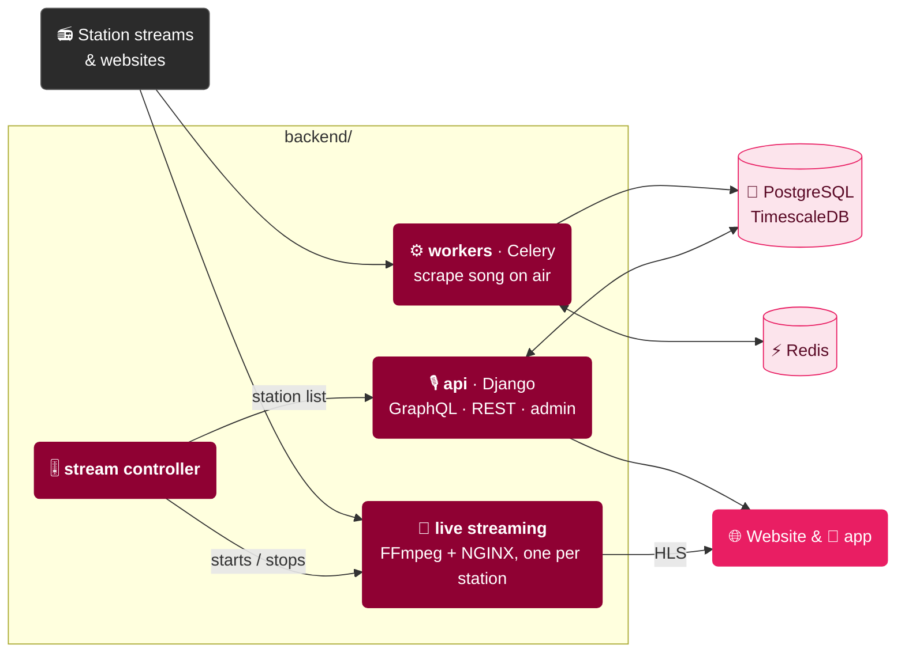

<p align="center">
  
</p>

<h1 align="center">Radio Crestin backend</h1>

<p align="center">
  The API, the admin portal and the live streaming behind
  <a href="https://www.radiocrestin.ro">radiocrestin.ro</a> and the Radio Crestin app.
</p>

<p align="center">
  
  &nbsp;
  
</p>

## ✨ What it does

- 📻 **Keeps the station list**: streams, logos, groups, descriptions, who may see a station
- 🎵 **Knows the song on air** on every station, by scraping each station's metadata (ID3, Icecast,
  Shoutcast, websites, RSS) with Celery workers, and keeps the history
- 🎧 **Counts listeners** and tracks each station's uptime
- 🎚️ **Re-streams every station as HLS**: one pod per station pulls the stream once and serves it to
  everyone, so a slow station server never stalls listeners
- ⭐ **Reviews, share links, announcements and push notifications** for the website and the app
- 🌐 **Serves it all** as GraphQL and REST at `api.radiocrestin.ro`, cached at the edge
- 🛠️ **Admin portal** (`admin.radiocrestin.ro`) for admins and station owners, built on Django Unfold

## ⚙️ How it works



## 🛠️ Quick start

Needs **Docker** (Docker Desktop, OrbStack or Colima) and `make`.

```bash
cd backend
cp .env.example .env          # local defaults; works as is
make start-docker             # PostgreSQL, Redis, the API, workers, beat and streaming
make migrate
make createsuperuser          # then sign in at http://localhost:8080/portal/
```

| Command (from `backend/`) | What it does |
|---|---|
| `make start-docker` / `make stop-docker` | Start or stop the whole stack |
| `make web-logs`, `make worker-logs` | Follow the API's or the workers' logs |
| `make makemigrations`, `make migrate` | Create and apply database migrations |
| `make run-all-scrapers` (in `api/`) | Scrape every station's song once, to test scrapers |
| `make dev-stream` | Run one station's live-streaming pod and open its dev player |
| `make dev-stream-test` | The same, then run the end-to-end HLS tests against it |

The local database starts empty: add stations in the admin portal, or ask the maintainers for a data
backup.

### Tests

Unit tests need only Python 3.14, no Docker. CI runs exactly these on every pull request that touches
`backend/`:

```bash
cd api
for f in requirements.txt $(find superapp -name requirements.txt); do cat "$f"; echo; done > /tmp/api-requirements.txt
pip install -r /tmp/api-requirements.txt -c constraints.txt pytest
SECRET_KEY=dev python manage.py check
SECRET_KEY=dev python -m pytest -q tests

cd ../streaming
pip install -r requirements.txt pytest
python -m pytest -q tests --ignore=tests/test_hls_stream.py --ignore=tests/test_segment_serving.py
```

The two ignored files test a running stream: `make dev-stream-test`.

## 🗂️ Project structure

```
backend/
├── api/                    Django project: GraphQL + REST API, admin portal, Celery tasks
│   └── superapp/apps/      One folder per feature: radio_crestin (stations, songs, reviews,
│                           announcements), radio_crestin_scraping, graphql, admin_portal, backups, …
├── streaming/              Live HLS streaming
│   ├── controller.py       Starts and stops one live-streaming pod per station (Kubernetes API)
│   ├── live_streaming/     The pod's image: FFmpeg + NGINX, with a dev player
│   ├── station_listing.py  Lists the stations the controller should run
│   └── tests/
├── station-thumbnails/     Original station artwork
├── deploy/                 Kubernetes deployment (private submodule, see below)
├── docs/screenshots/       The images in this README
├── docker-compose.yaml     The local stack
└── Makefile                Everyday commands
```

Coding conventions (services, admins, i18n, file layout): [`CLAUDE.md`](CLAUDE.md) and
[`api/CONVENTIONS.md`](api/CONVENTIONS.md).

## 🚀 Deploying

Production runs on Kubernetes. Everything about it lives in
[`radio-crestin-deploy`](https://github.com/radio-crestin/radio-crestin-deploy), a **private** repository
checked out as the `deploy/` submodule. Its secrets are encrypted with git-crypt. The submodule is marked
`update = none`, so ordinary clones (and Cloudflare's website builds) skip it; fetch it explicitly:

```bash
git submodule update --init --checkout backend/deploy   # needs access to the private repo
cd backend/deploy && make unlock-git-crypt        # needs the git-crypt key
```

To release, from `backend/`:

1. `make create-new-release` bumps the image tag (`v1.1.187`), builds and pushes the images, generates the
   manifests, commits them in `deploy/`, bumps the submodule and tags `backend/v1.1.187`.
2. Push `deploy/`, then `git push origin HEAD backend/v1.1.187`. The tag publishes a
   [GitHub release](https://github.com/radio-crestin/radiocrestin.ro/releases) with the backend's changes.
3. Apply the generated manifests to the cluster: the kubectl recipes are in [`CLAUDE.md`](CLAUDE.md#deployment).

Part of the [Radio Crestin monorepo](../README.md).
