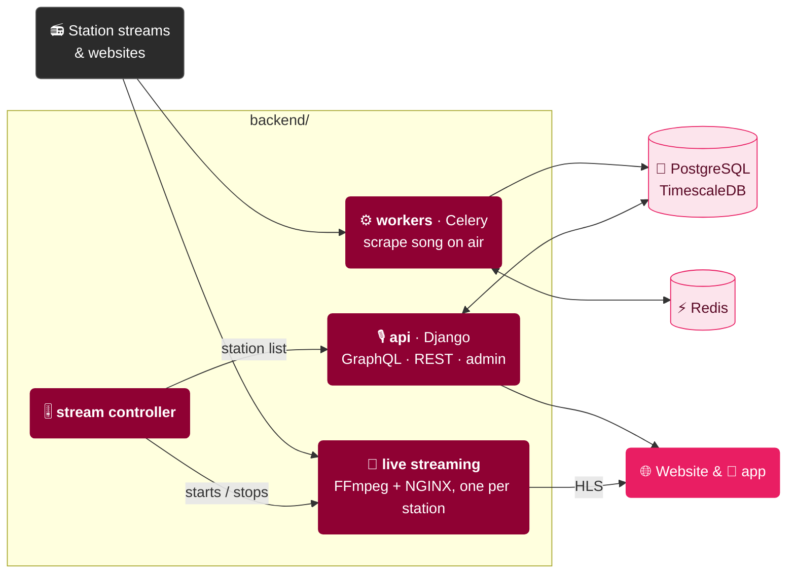

<p align="center">
  
</p>

<h1 align="center">Radio Crestin backend</h1>

<p align="center">
  The API, the admin portal and the live streaming behind
  <a href="https://www.radiocrestin.ro">radiocrestin.ro</a> and the Radio Crestin app.
</p>

<p align="center">
  
  &nbsp;
  
</p>

## ✨ What it does

- 📻 **Keeps the station list**: streams, logos, groups, descriptions, who may see a station
- 🎵 **Knows the song on air** on every station, by scraping each station's metadata (ID3, Icecast,
  Shoutcast, websites, RSS) with Celery workers, and keeps the history
- 🎧 **Counts listeners** and tracks each station's uptime
- 🎚️ **Re-streams every station as HLS**: one pod per station pulls the stream once and serves it to
  everyone, so a slow station server never stalls listeners
- ⭐ **Reviews, share links, announcements and push notifications** for the website and the app
- 🌐 **Serves it all** as GraphQL and REST at `api.radiocrestin.ro`, cached at the edge
- 🛠️ **Admin portal** (`admin.radiocrestin.ro`) for admins and station owners, built on Django Unfold

## ⚙️ How it works



## 🛠️ Quick start

Needs **Docker** (Docker Desktop, OrbStack or Colima) and `make`.

```bash
cd backend
cp .env.example .env          # local defaults; works as is
make start-docker             # PostgreSQL, Redis, the API, workers, beat and streaming
make migrate
make createsuperuser          # then sign in at http://localhost:8080/portal/
```

| Command (from `backend/`) | What it does |
|---|---|
| `make start-docker` / `make stop-docker` | Start or stop the whole stack |
| `make web-logs`, `make worker-logs` | Follow the API's or the workers' logs |
| `make makemigrations`, `make migrate` | Create and apply database migrations |
| `make run-all-scrapers` (in `api/`) | Scrape every station's song once, to test scrapers |
| `make dev-stream` | Run one station's live-streaming pod and open its dev player |
| `make dev-stream-test` | The same, then run the end-to-end HLS tests against it |

The local database starts empty: add stations in the admin portal, or ask the maintainers for a data
backup.

### Tests

Unit tests need only Python 3.14, no Docker. CI runs exactly these on every pull request that touches
`backend/`:

```bash
cd api
for f in requirements.txt $(find superapp -name requirements.txt); do cat "$f"; echo; done > /tmp/api-requirements.txt
pip install -r /tmp/api-requirements.txt -c constraints.txt pytest
SECRET_KEY=dev python manage.py check
SECRET_KEY=dev python -m pytest -q tests

cd ../streaming
pip install -r requirements.txt pytest
python -m pytest -q tests --ignore=tests/test_hls_stream.py --ignore=tests/test_segment_serving.py
```

The two ignored files test a running stream: `make dev-stream-test`.

## 🗂️ Project structure

```
backend/
├── api/                    Django project: GraphQL + REST API, admin portal, Celery tasks
│   └── superapp/apps/      One folder per feature: radio_crestin (stations, songs, reviews,
│                           announcements), radio_crestin_scraping, graphql, admin_portal, backups, …
├── streaming/              Live HLS streaming
│   ├── controller.py       Starts and stops one live-streaming pod per station (Kubernetes API)
│   ├── live_streaming/     The pod's image: FFmpeg + NGINX, with a dev player
│   ├── station_listing.py  Lists the stations the controller should run
│   └── tests/
├── station-thumbnails/     Original station artwork
├── docs/screenshots/       The images in this README
├── docker-compose.yaml     The local stack
└── Makefile                Everyday commands
```

Coding conventions (services, admins, i18n, file layout): [`CLAUDE.md`](CLAUDE.md) and
[`api/CONVENTIONS.md`](api/CONVENTIONS.md).

## 🚀 Deploying

Production runs on the `prod-rke2` Kubernetes cluster. Its config lives in the **private**
[`bringes-infrastructure`](https://github.com/bringes/bringes-infrastructure) repository, environment
`environments/radio_crestin_production` (one Fleet HelmOp per component; its README is the full guide).
To ship the backend from `main`, in `bringes-infrastructure`:

1. Build the image from a checkout of `main` (tag `YYYY.MM.DD-N`):
   `docker buildx build --load --platform linux/amd64 -f backend/api/Dockerfile -t ghcr.io/radio-crestin/radio-crestin-backend:<tag> backend/api`
   (`cli/bringes app build --env radio_crestin_production --image backend --checkout <path> --tag <tag>` prints it).
2. Pass the CVE gate, from `environments/bringes_production`:
   `make admit-images IMAGES="ghcr.io/radio-crestin/radio-crestin-backend:<tag>" SOURCE=local-radio-crestin-backend-<tag> ARGS=--from-docker`
3. Set `<tag>` on `web`, `priorityWorker` and `worker` in `environments/radio_crestin_production/config/radio_crestin.yaml`,
   then `make generate-manifests` there.
4. Roll it out: `scripts/reconcile_fleet_applications.py --env environments/bringes_production
   --name radio-crestin-production-radio-crestin-backend-app --apply --verify --wait` (migrations run as a Job).
   If Fleet reports `chart version cannot be deployed: invalid characters in version`, it is ignoring the update
   (the chart version only hashes the chart, not the values): raise the HelmOp's `spec.forceSyncGeneration` by one.
5. Commit the tag bump and the new `registry/images/local-radio-crestin-backend-<tag>.yaml` lock.

The stream controller, streamer and station-listing images follow the same steps (their `build:` entries in
`radio_crestin.yaml`).

**A new station's hosts must be allowed first.** The cluster reaches the internet only through an egress
proxy: add the station's stream, metadata and website hosts to `radio-streams.allow` in
`environments/bringes_production/config/egress_proxy.yaml`, then apply it
(`terraform -chdir=environments/bringes_production apply -target='module.infrastructure.module.egress_proxy[0]'`).
Until then its pod logs `input_relay: upstream unreachable`, the uptime check fails with
`Tunnel connection failed: 403 Forbidden`, and the apps show the station as unavailable.

The image tag is the deploy's own counter. GitHub releases carry the repository's one version, for every
app at once: [how to release](../README.md#-releases).

Part of the [Radio Crestin monorepo](../README.md).
