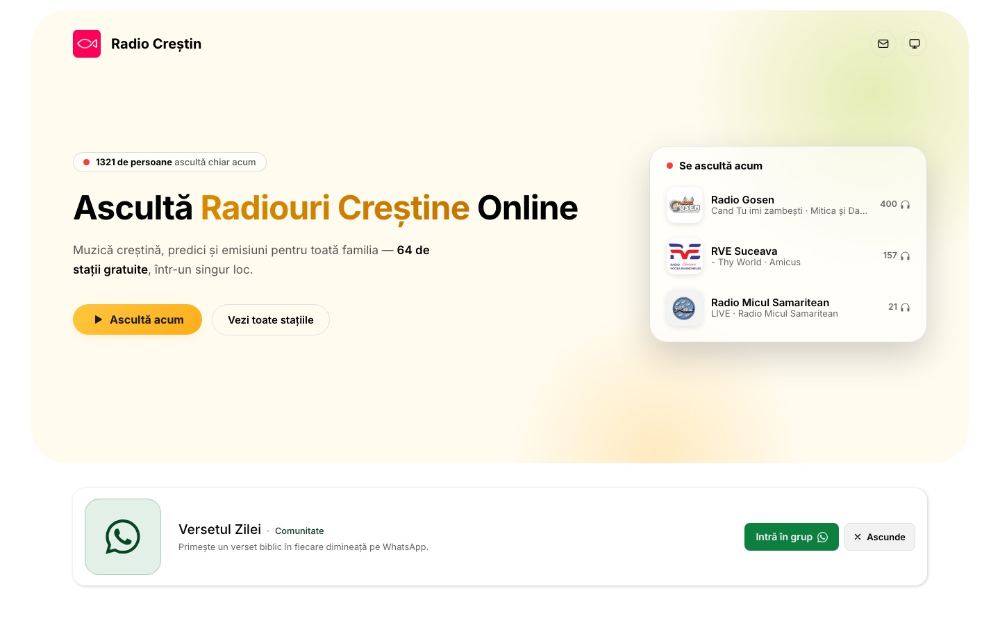
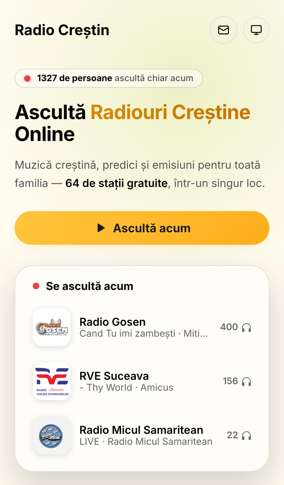
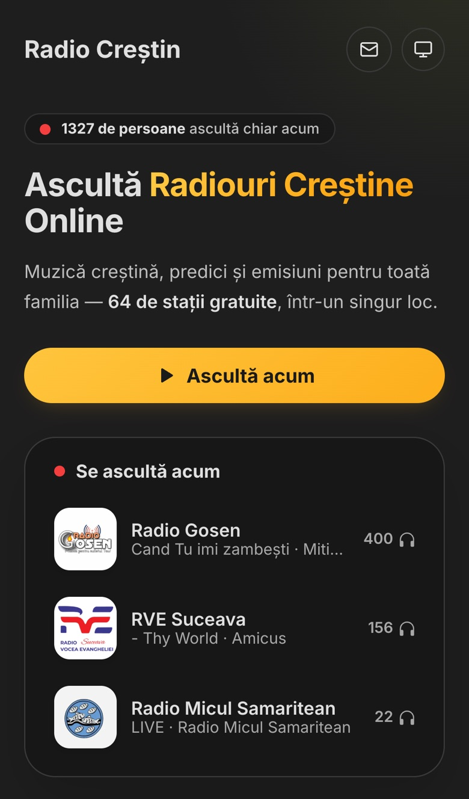

<p align="center">
  
</p>

<h1 align="center">radiocrestin.ro</h1>

<p align="center">
  The website: every Romanian Christian radio station, the song on air, how many people listen,
  reviews and listening stats. Open it, tap a station, it plays.
</p>

<p align="center">
  <a href="https://www.radiocrestin.ro"><b>🌐 www.radiocrestin.ro</b></a>
</p>

<p align="center">
  
</p>

<p align="center">
  
  &nbsp;
  
  &nbsp;
  
</p>

## ✨ Features

- 📻 **Every station on one page**, each with the song on air and its listeners, refreshed live
- ▶️ **Plays in the browser**: HLS first, the station's own stream as fallback, and a player that follows
  you from page to page
- ⭐ **Reviews and ratings** for every station
- ❤️ **Favorites** and a "Pentru tine" sort that learns what you listen to
- 📊 **Listening stats** (`/statistici`) and the songs each station played recently
- 📣 **Announcements** managed from the backend admin, shown without layout shift
- 🌙 **Light and dark themes**, fast on any phone: a static site with small React islands
- 🔎 **Built for search**: one page per station, JSON-LD, sitemap and `llms.txt` generated at build

## 🛠️ Quick start

Needs **Node 24** (or newer) and npm.

```bash
cd web
npm ci
npm run dev        # http://localhost:3005, against the production API
```

| Command | What it does |
|---|---|
| `npm run dev` | Dev server on port 3005 |
| `npm test` | Unit tests (Vitest) |
| `npm run build` | The production build: station thumbnails, sitemap, `llms.txt`, the site in `dist/`, then the source-map upload |
| `npx astro build` | Just the site, offline-friendly (what CI runs) |
| `npm run preview` | Serves `dist/` on port 3005 |
| `npm run deploy` | Builds and deploys the Worker by hand (Workers Builds normally does this) |

### Settings

All optional. Put them in your shell or in `web/.env`:

| Variable | Default | Use |
|---|---|---|
| `PUBLIC_ANNOUNCEMENTS_API_BASE` | production API | Point announcements at a local backend: `http://localhost:8080/api/v1` |
| `PUBLIC_CONTACT_API_URL` | production API | Send the contact form to a local backend |
| `PUBLIC_TURNSTILE_SITE_KEY` | empty (no captcha) | Cloudflare Turnstile on the contact form |
| `POSTHOG_API_KEY`, `POSTHOG_PROJECT_ID` | empty (skipped) | Upload source maps to PostHog during `npm run build` |

## 🗂️ Project structure

```
web/
├── src/
│   ├── pages/              Astro pages: home, [station_slug], statistici, contact, …
│   ├── layouts/            BaseLayout: head, Open Graph, JSON-LD
│   └── common/
│       ├── components/     React components (RadioApp is the home and station page island)
│       ├── services/       API calls (falls back to data/fallback-stations.json)
│       ├── store/          Zustand stores
│       └── utils/          SEO, announcements, helpers
├── public/                 Static files, icons
├── scripts/                Build-time generators: sitemap, llms.txt, thumbnails, source maps
└── docs/screenshots/       The images in this README
```

Conventions, SEO rules and how announcements work: [`CLAUDE.md`](CLAUDE.md).

## 🚀 Deploying

The site is an **assets-only Cloudflare Worker**, `radiocrestin-ro` ([`wrangler.jsonc`](wrangler.jsonc)): no Worker
code runs, so every request is served from Cloudflare's asset store and edge cache, free and unmetered.

- **Workers Builds** builds it on every push to `main` that changes `web/` (root `web`, `npm run build`,
  then `npx wrangler deploy`), and uploads a preview version for every pull request.
- **Routing:** the route `www.radiocrestin.ro/*` sends the site's traffic to the Worker. The proxied `www` DNS
  record stays in `bringes-infrastructure`; removing the route falls back to that record's origin.
- **Headers and redirects:** `public/_headers` (caching, security, CORS) and the generated `dist/_redirects`
  (permanent `/x` → `/x/`).
- **Deploy by hand:** `npm run deploy` (builds, then `wrangler deploy`).
- **Releases:** the website shares the repository's one version; each release lists what changed in `web/`
  ([how to release](../README.md#-releases)).

Part of the [Radio Crestin monorepo](../README.md).
